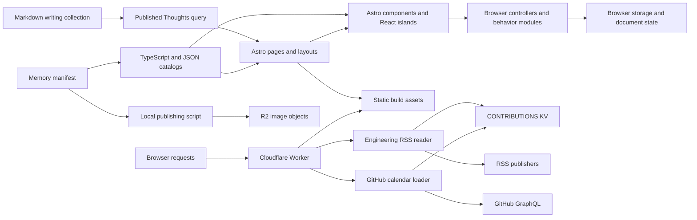

# Architecture map

This map tracks the application as it exists. [Decisions](decisions.md) record
the interfaces adopted during governance. The [backlog](backlog.md) records
ownership conflicts and gaps. [Progress](progress.md) records executed checks.

## Entry points and dependency direction



The generated graph includes relative and `/src/` imports, re-exports,
literal dynamic and type imports, Astro scripts and local CSS imports.
JSON and other source assets are leaves. Runtime DOM selectors, custom events,
storage keys and HTTP contracts are described below.

```sh
node scripts/check-architecture.mjs --graph
```

The round-one snapshot (`c1dbccc`) has 188 source files and 246 local dependency edges.
The check rejects cycles, unresolved local imports and catalog dependencies on
UI and runtime entry points. `pnpm verify` runs it with the other source and
built-output checks.

## Ownership and contracts

| Area | Owner and interface | Relevant contracts |
| --- | --- | --- |
| Routes and shared chrome | `src/pages`, `src/layouts/Layout.astro`, `ParentLink.astro` | Standalone pages have explicit parents. Overlays use their close hooks. Keep direct URLs, legacy writing redirects and browser history semantics. |
| Collections | `src/data/collections.ts`, `Folder.astro`, feature showcase controllers | Homepage previews and overlay handoff are separate responsibilities. Projects derives visual order and count from `src/data/projects.ts`. Music and Books have feature-specific motion. |
| Writing | `src/content/writing`, `getPublishedThoughts`, `ArticleLayout`, `article-sharing.ts` | Drafts stay unpublished. Homepage announcement and lists use newest-first publication order. Article routes, canonical URLs, note markup and Markdown export retain their contracts. The folder teaser currently pins one article. |
| Catalogs and images | `src/data`, `src/content.config.ts`, `scripts/publish-memory.mjs` | Catalog IDs and ordering feed visual transitions and direct routes. Memory records bind dimensions and month to local or published image URLs. The publisher targets R2 and updates the manifest after uploads. |
| Engineering Radio | `engineering-blogs.mjs`, `engineering-feed.js`, `engineering-radio.ts` | Source order defines channel IDs. The Worker serves the JSON endpoint and injects the feed into the prerendered homepage. The client owns the selected channel, command prompt, archive order and animation state. |
| GitHub calendar | `worker.js`, `GitHubContributions.astro` | The Worker keeps the token on the server. The public calendar payload, cache headers, `github-contributions:v1` key, daily Cron and 24-hour freshness are existing contracts. |
| KV and retry policies | `wrangler.jsonc`, `worker.js`, `engineering-feed.js` | The shared namespace has separate key formats and policies. RSS uses per-source freshness, retention and retry timing. A loopback Worker entrypoint gives each RSS parse its own invocation. |
| Worker routing and faults | `worker.js`, `wrangler.jsonc` | Assets serve prerendered routes. The homepage HTML and two public JSON routes run through the Worker. Request handlers own response status, cache headers and logging. |
| Configuration and verification | `package.json`, `pnpm-workspace.yaml`, `astro.config.mjs`, `wrangler.jsonc`, `scripts/verify.mjs` | Node.js 22 and a pinned pnpm version. Vite caches are keyed by command and mode. Cloudflare owns its bindings and deploy configuration. Pull requests and main commits use the local verification command. |

## State ownership

| State | Current owner | Crossing point |
| --- | --- | --- |
| Home theme | Home inline bootstrap and `theme-dial.ts`; standalone Uses, Music and Books bootstraps | `home-theme` in local storage. `data-home-mode` and `data-home-theme` connect browser state to CSS. Several routes currently resolve it independently. |
| Home collection navigation | `Folder.astro`, feature controllers and Music's standalone controller | History state and `data-*-stage` hooks connect the homepage, overlays and direct pages. |
| Chat, Moments and email | Feature components and pure behavior modules where they exist | Feature events coordinate the Dock and other surfaces. Several components directly acquire and restore document scroll and inert state. |
| Finds browsing position | `FindsCabinet.tsx` | `finds-position` in session storage. Drawer and selected card stay local to the cabinet. |
| Audio playback and feedback | `music-preview.ts`, return, wake and step sound modules | Visibility, media events and gesture unlocks have feature-specific timing. Reuse each sound module's public behavior. |
| Remote feed snapshots | Worker and per-feed loaders | Cloudflare KV and request-life-cycle continuations. No remote feed credentials belong in islands or prerendered HTML. |
